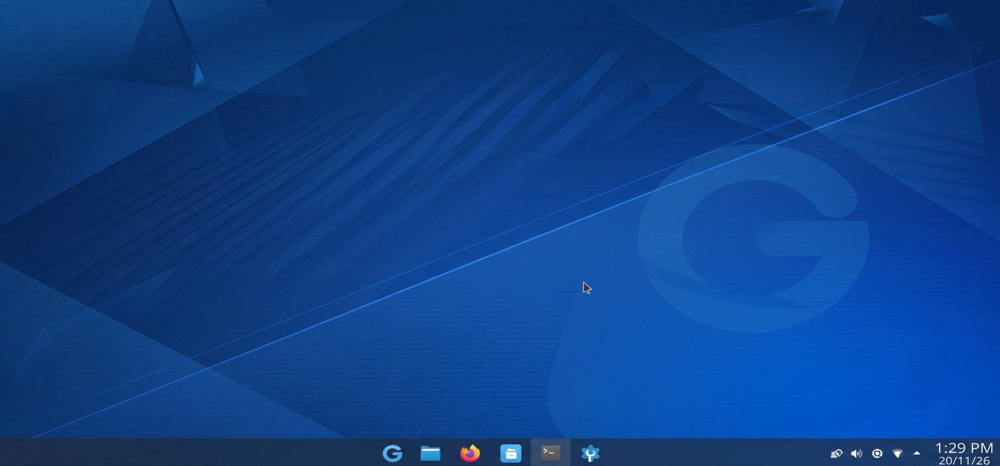
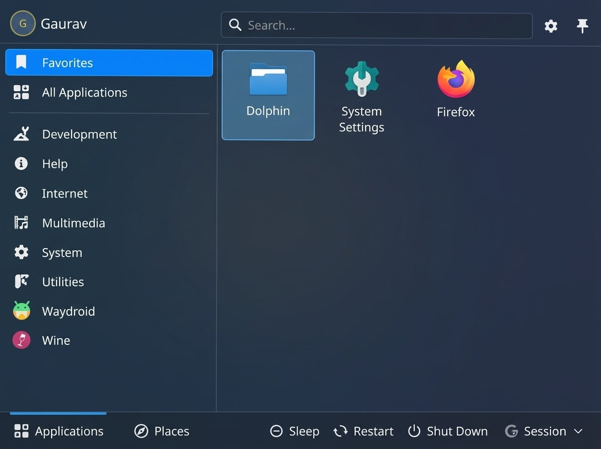
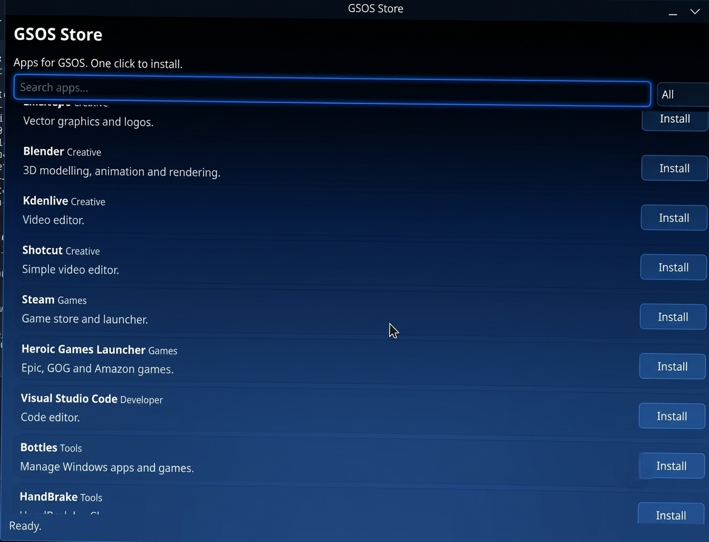

# GSOS (Arch Linux)

**GSOS** is a custom Arch Linux-based operating system engineered to be a clean, responsive, and dependable daily-driver[span_4](start_span)[span_4](end_span)[span_5](start_span)[span_5](end_span). Built with `mkarchiso` and automated via GitHub Actions, GSOS brings together a dark slate-and-electric-blue visual identity, Kiosk-locked KDE/KWin settings, a centered bottom panel/dock, custom Python/PyQt6 desktop tools, and Calamares installer integration[span_6](start_span)[span_6](end_span)[span_7](start_span)[span_7](end_span)[span_8](start_span)[span_8](end_span).

---

## Visual Tour 

### 1. Desktop & Custom Wallpaper
A dark slate-and-blue KDE Plasma desktop featuring the custom GSOS **"G"** wallpaper, a centered bottom dock/taskbar with quick launch icons, and system tray controls[span_9](start_span)[span_9](end_span).



### 2. Application Launcher
Clean navigation across `Favorites`, `All Applications`, and categories (`Development`, `Help`, `Internet`, `Multimedia`, `System`, `Utilities`, `Waydroid`, `Wine`), paired with quick power and session controls (`Sleep`, `Restart`, `Shut Down`, `Session`)[span_10](start_span)[span_10](end_span).



### 3. GSOS Store
A custom PyQt6 application manager built for browsing, searching, and installing curated software (`Blender`, `Kdenlive`, `Shotcut`, `Steam`, `Heroic Games Launcher`, `Visual Studio Code`, `Bottles`, `HandBrake`, and more) with one-click actions[span_11](start_span)[span_11](end_span).



---

## Key Features & Architecture

* **Base & Kernel:** Built from Arch Linux using `mkarchiso` and paired with the `linux-zen` kernel for everyday responsiveness and desktop interactivity.
* **Cohesive KDE Plasma Aesthetic:** Custom dark slate surfaces paired with electric-blue highlights, `Papirus-Dark` icon theme, custom wallpaper/branding/splash screen (`org.gsos.splash`), bottom taskbar/dock layout, and right-aligned window controls (`IAX`).
* **Immutable & Locked Settings:** Uses Kiosk restrictions and read-only KDE/KWin configuration keys (`[$i]`) so core visual consistency and layout behavior are preserved.
* **Automated First-Login Setup:** Runs once-per-user initialization (`gsos-first-login.sh`) to handle performance profile selection, Flathub setup, `plasmashell` panel/taskbar configuration, wallpaper assignment, and launching Calamares when running on the live ISO.
* **Custom Native Utilities (Python / PyQt6):**
  * **GSOS Store (`gsos-store.py`):** Curated application catalog and installer backed by Flatpak/Flathub.
  * **About GSOS (`gsos-about.py`):** Lightweight system and hardware overview tool supporting hostname changes and one-click clipboard copy.
* **Installer & Target System Prep:** Includes Calamares branding and post-install chroot preparation (`shellprocess-gsos-prep.conf`) so a fresh installation transitions cleanly from the live environment to a standard installed OS.
* **CI/CD Automation:** Automated, repeatable ISO generation via GitHub Actions (`build gsos.yml`).

---

## Under the Hood

### Desktop & Theme Layer
* **Color & Iconography:** Dark slate and blue theme accents combined with `Papirus-Dark` icons and custom GSOS logos/wallpapers across the live environment[span_12](start_span)[span_12](end_span)[span_13](start_span)[span_13](end_span).
* **Startup & Windowing:** Custom splash screen (`org.gsos.splash`), bottom panel layout, and right-aligned window button layout (`IAX`).
* **Configuration Guardrails:** Locked keys (`[$i]`) and Kiosk policies prevent accidental drift in core desktop settings while keeping the system practical to use.

### Native Desktop Apps
* **GSOS Store:** Designed around straightforward discovery and installation of creative tools, gaming launchers, development editors, and compatibility layers (such as `Blender`, `Kdenlive`, `Shotcut`, `Steam`, `Heroic Games Launcher`, `Visual Studio Code`, `Bottles`, and `HandBrake`)[span_14](start_span)[span_14](end_span).
* **About GSOS:** Provides quick visibility into system/hardware details alongside practical utilities like updating the machine hostname and copying system info to the clipboard.

### Live ISO to Installed System
* On the **live ISO**, first-login scripts prepare the session—including Flathub setup, performance profile hooks, panel/wallpaper setup, and launching Calamares.
* During **installation**, Calamares branding and `shellprocess-gsos-prep.conf` handle post-install chroot steps so the installed system boots cleanly as a standalone GSOS setup.

---

## Repository Structure

```text
├── .github/
│   └── workflows/
│       └── build gsos.yml          # GitHub Actions workflow ("Build GSOS ISO")
├── gsos-archiso/
│   ├── airootfs/                   # Live filesystem overlay (etc, root, usr)
│   ├── scripts/
│   │   └── gsos-theme.sh           # Main theme, apps, autostart, and branding bundle script
│   ├── BUILD_GSOS.md               # Build documentation and notes
│   └── packages.x86_64             # Archiso package list
├── yours/
│   ├── gsos-profile-switcher       # Performance profile utility
│   ├── gsos-theme-installer        # Theme installer script
│   └── metadata.json               # Custom metadata
├── 1795178828224.png               # 1. Desktop screenshot
├── 1795178832022.jpg               # 2. Application launcher screenshot
├── 1795178814912.png               # 3. GSOS Store screenshot
├── BUILD_GSOS.md
├── LICENSE
└── README.md
